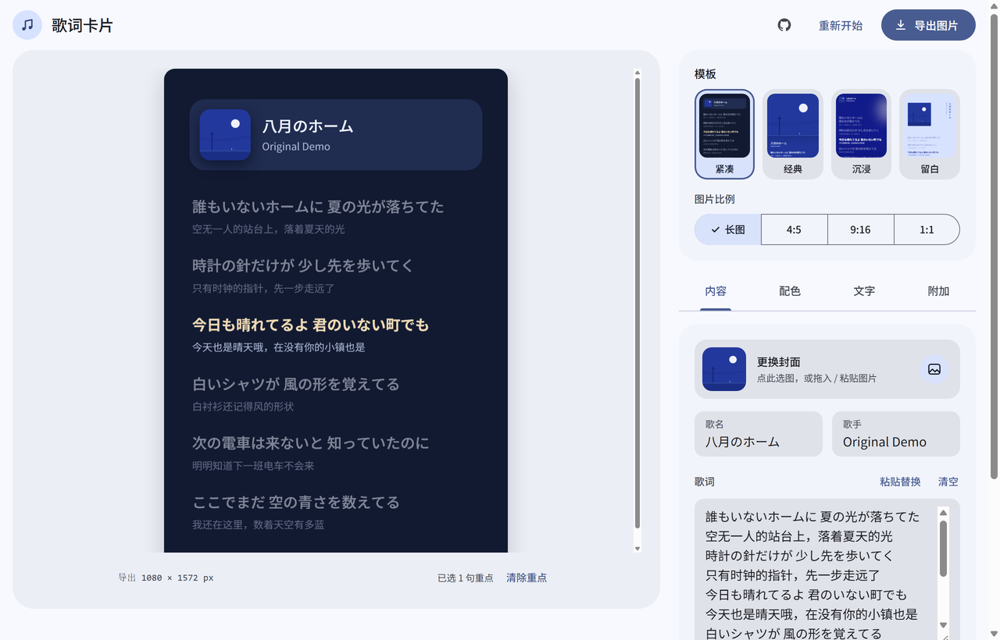

# 歌词分享图片生成器

一个纯前端、零构建的歌词分享图片生成工具。填入封面、歌名、歌手和双语歌词，自动从封面提取动态配色，一键导出高清 PNG 分享图。

- **在线体验**：https://lyrics.sw0721.me/
- **开源协议**：GNU AGPL-3.0（见 [LICENSE](./LICENSE)）
- **隐私说明**：封面图片、歌词文本与自定义字体全部在浏览器本地处理，不上传任何服务器。



## 特性

- **封面动态取色（OKLCH + Material 3 色彩角色）**：上传、拖入或直接 `Ctrl+V` 粘贴封面图后，自动提取主色并生成高对比度配色，支持「忠实 / 柔和 / 鲜明 / 单色」四种风格、明暗切换及自选主色，页面自身主题也会同步跟随。
- **四套精炼模板**：
  - **紧凑**：小封面顶栏 + 宽松双语歌词，适合较长歌词分享；
  - **经典**：顶部封面自然溶入背景色，视觉平衡；
  - **沉浸**：封面高斯模糊 + 胶片颗粒背景，适合竖屏动态；
  - **留白**：大面积留白 + 右侧竖排歌名，短句舒展、长词自适应延展。
- **专为复制歌词优化**：自动去除 LRC 时间轴，支持 **交替双语 / 空行分段 / 纯单语** 三种排列与 CJK 避头尾换行；支持一键粘贴替换与清空。
- **可选重点句与附加项**：默认只保留封面、歌名、歌手与歌词；可直接在预览图或折叠列表里点选重点句，也可按需开启日期、角落小字、进度条或二维码。
- **手机端优先体验**：窄屏下采用「固定顶部实时预览 + 底部抽屉与导航栏（内容 / 模板 / 配色 / 文字 / 附加）」，编辑文字时预览自动收折为迷你条，调外观时实时可见；支持 1080 宽 / 2160 宽 PNG 导出、长按保存与系统分享。
- **字体与离线支持**：内置黑体、明朝、圆体、手写四种预设，也支持导入本地 `.ttf / .otf / .woff / .woff2`；带 PWA Manifest 与 Service Worker 离线缓存。


## 本地运行

项目无构建步骤，使用浏览器原生 ES 模块，任选一种方式启动静态服务即可（不要直接双击 `index.html` 以 `file://` 打开）：

```bash
# 方式一：Node 22+（推荐，自带正确的 MIME 与缓存头）
node server.mjs

# 方式二：Python 3
python -m http.server 8080
```

启动后访问 `http://localhost:8080/`。

## 目录结构

```text
index.html                页面结构
styles/app.css            界面样式（Material 3 动态变量 + 手机端适配）
src/app.js                界面状态、本地存储、响应式调度与导出
src/config.js             字体样式表地址与版本号
src/storage.js            localStorage 与 IndexedDB 封装
src/color.js              封面像素取色、OKLCH 色板与对比度保障
src/lyrics.js             LRC 去时间轴与双语歌词分组解析
src/text.js               CJK 避头尾与孤字修复折行算法
src/render/               Canvas 2D 绘制工具与四套模板
vendor/qrcode.js          二维码生成库（MIT）
manifest.webmanifest      PWA 清单
sw.js                     Service Worker 离线缓存
server.mjs                零依赖静态文件服务（可直接用于自部署）
tests/logic.test.mjs      配色、歌词、折行单元测试
```

## 自部署说明

将静态文件部署到任意 HTTPS 站点（支持放在子路径，全部使用相对路径）：

- 分享、复制图片、离线缓存和「添加到主屏幕」需要 **HTTPS**（`localhost` 除外）。
- `.webmanifest` 需返回 `application/manifest+json`，`index.html` 与 `sw.js` 建议设置 `Cache-Control: no-cache`。
- **字体镜像配置**：`src/config.js` 中的 `FONT_CSS_URL` 默认使用 `fonts.loli.net` 镜像以便国内访问；可按需换回 Google Fonts、自建字体样式表，或改为空字符串 `''` 仅使用系统字体。

使用 `node server.mjs` 启动后，可通过 Caddy / Nginx 反代到 `8080` 端口即可上线。

## 运行测试

需要 Node.js 22+：

```bash
node tests/logic.test.mjs
```

## 开源协议与致谢

本项目基于 **GNU Affero General Public License v3.0 (AGPL-3.0)** 开源，详见 [LICENSE](./LICENSE)。

简而言之：你可以自由使用、修改和自部署本项目；**但如果你修改了本项目并将其作为网络服务向公众提供，必须保留原作者版权声明并同样以 AGPL-3.0 协议公开修改后的完整源代码。**

第三方开源组件许可见 [THIRD_PARTY_NOTICES.md](./THIRD_PARTY_NOTICES.md)。
